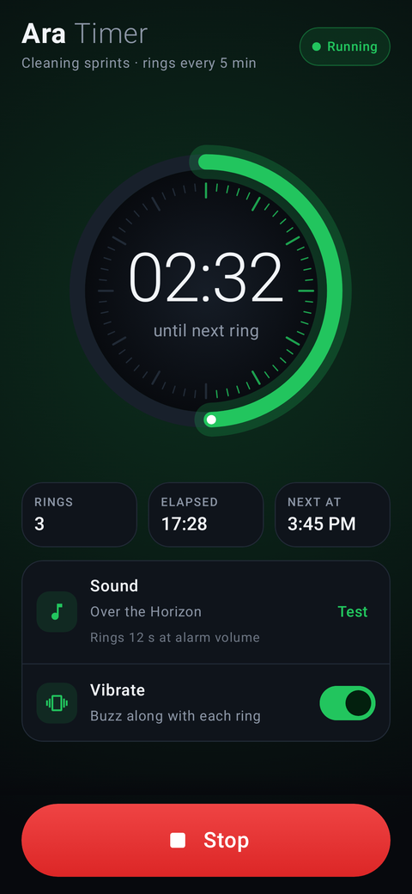
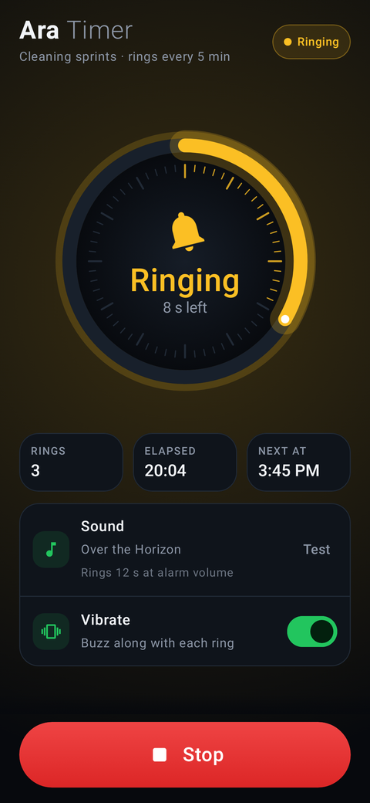

# Ara Timer

A cleaning productivity timer for Android. Press **Start** and the phone plays its
default ringtone **every 5 minutes**. Each ring lasts **12 seconds** and then stops, and
the cycle repeats until you press **Stop**. It was built for a Samsung Galaxy A56 5G
(Android 15 / One UI 7, and Android 16 / One UI 8) and runs on Android 8.0 or later.

| Ready | Running | Ringing |
|---|---|---|
|  |  |  |

## Install on your phone

1. On the phone, download [`release/AraTimer-v1.0.apk`](release/AraTimer-v1.0.apk)
   (open it on GitHub and tap **Download raw file**).
2. Open the downloaded file from the notification or from **My Files → Downloads**.
3. If asked, allow your browser or My Files to **Install unknown apps**, then tap **Install**.
   Play Protect may say the app is from an unknown developer. Tap **More details →
   Install anyway**. That warning appears for any app that isn't from the Play Store.
4. Open **Ara Timer** and tap **Start**. Allow notifications when asked, so the
   countdown and a Stop button appear in the notification shade and on the lock screen.

**For the most reliable rings with the screen off:** go to Settings → Apps → Ara Timer →
Battery and choose **Unrestricted**. The app offers a shortcut to this setting.

## How it behaves

- **First ring is 5:00 after Start**, then 10:00, 15:00, and so on. The schedule stays
  fixed to when you pressed Start, so it never drifts.
- **Each ring plays for exactly 12 seconds**, then stops. A short ringtone loops to fill
  the 12 seconds.
- **The sound is your phone's ringtone** (Settings → Sounds and vibration → Ringtone). On
  an A56 that hasn't been customised, this is Samsung's default ringtone. If the ringtone
  is set to silent, the alarm sound plays instead.
- **It plays at alarm volume**, so you hear it even when the phone is on vibrate or
  silent. If the alarm volume is at zero, the app warns you and offers a **Turn up**
  button. Use **Test** to hear it.
- **Music keeps playing**, quieter, while the ring plays. During a phone call the ring
  vibrates only.
- **Vibrate** (on by default) buzzes along with each ring.
- **Stop** works from the app or from the notification, including during a ring. Rings
  continue until you stop the timer. Leaving the app or locking the phone does not
  stop it.

## Reliability details

- A foreground service with an ongoing notification keeps the timer running.
- Exact wake-up alarms (`setExactAndAllowWhileIdle`, `USE_EXACT_ALARM`) wake the phone on
  time even in deep sleep (Doze) with the screen off. An in-app timer covers the time the
  phone is already awake. Both feed one check, so a ring never plays twice.
- The CPU is kept awake only during the 12-second ring. Between rings the phone can sleep,
  so battery use stays low.
- If Android kills the app, the next alarm restarts it and the ring still plays.
  Opening the app also resumes a running session.
- A ring that arrives late (phone very deeply asleep) still plays if it is up to 2½
  minutes late. Otherwise it is skipped, so you never get two rings close together.
- A session from before a reboot is discarded instead of resumed.
- Without the exact-alarm permission (Android 12–13 only), the app keeps the CPU awake
  for the whole session so its own timer stays accurate.

## Build from source

Requirements: JDK 17 or newer and the Android SDK (platform 36). Point to the SDK with
`ANDROID_HOME` or a `local.properties` file containing `sdk.dir=...`.

```bash
./gradlew assembleRelease        # app/build/outputs/apk/release/app-release.apk
./gradlew testDebugUnitTest      # unit, service and UI tests (Robolectric)
./gradlew lintDebug
```

The UI tests also save screenshots to `app/build/screenshots/`.

### Signing

Without extra setup, the release build is signed with the local debug key, which is enough
to install it. Android only installs an update over an existing copy when both are
signed with the same key. An APK built on another machine has a different key, so
uninstall the old one first. Your only setting is the vibrate toggle, so you lose nothing.

To sign with your own key, create `keystore.properties` in the project root. It is
git-ignored, so keep it and the keystore somewhere safe.

```properties
storeFile=/path/to/ara-timer.jks
storePassword=...
keyAlias=ara
keyPassword=...
```

## Project layout

| File | Role |
|---|---|
| `TimerService.kt` | Foreground service: schedules, plays and stops each ring |
| `TimerController.kt` | Start / Stop / alarm entry points |
| `RingPlayer.kt` | Ringtone playback (alarm channel, looping, focus, vibration, fallbacks) |
| `Alarms.kt` | Exact wake-up alarms and wake-lock helpers |
| `Session.kt` | Schedule maths (pure Kotlin, unit tested) |
| `TimerRepository.kt` | Shared state, persisted across process death |
| `ui/TimerScreen.kt` | Jetpack Compose UI |
