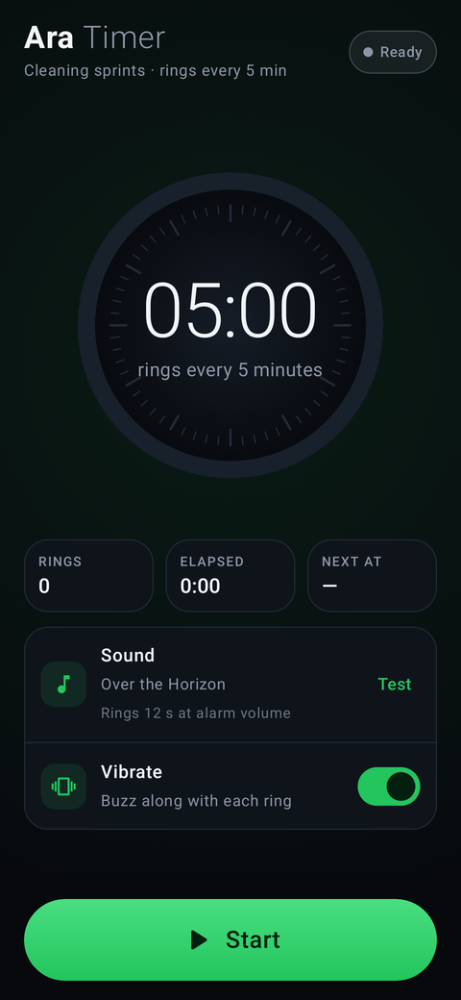

# Ara Timer

A cleaning productivity timer for Android. Press **Start** and it counts down **5 minutes**,
then plays the phone's default ringtone for **12 seconds**. While it rings, the timer is
**paused**: the countdown and the elapsed time both stop. When the ring ends, the next
5-minute countdown starts. This repeats until you press **Stop**.

It was built for a Samsung Galaxy A56 5G (Android 15 / One UI 7, and Android 16 /
One UI 8) and runs on Android 8.0 or later.

| Ready | Counting down | Ringing (timer paused) |
|---|---|---|
|  |  |  |

## Install on your phone

1. On the phone, download [`release/AraTimer-v1.1.apk`](release/AraTimer-v1.1.apk)
   (open it on GitHub and tap **Download raw file**).
2. Open the downloaded file from the notification or from **My Files → Downloads**.
3. If asked, allow your browser or My Files to **Install unknown apps**, then tap **Install**.
   Play Protect may say the app is from an unknown developer. Tap **More details →
   Install anyway**. That warning appears for any app that isn't from the Play Store.
4. Open **Ara Timer** and tap **Start**. Allow notifications when asked, so the
   countdown and a Stop button appear in the notification shade and on the lock screen.

**Updating from 1.0:** install 1.1 straight over it; you don't need to uninstall. A timer
that is running during the update stops, so press Start again afterwards.

**For the most reliable rings with the screen off:** go to Settings → Apps → Ara Timer →
Battery and choose **Unrestricted**. The app offers a shortcut to this setting.

## How it behaves

```
Start ─ 5:00 countdown ─ ring 12 s (paused) ─ 5:00 countdown ─ ring 12 s (paused) ─ … ─ Stop
```

- **Each ring comes after 5 full minutes of countdown.** By the clock, the rings start 5:00,
  10:12, 15:24, and so on after you press Start.
- **While it rings, the timer is paused.** The dial shows "Ringing · Timer paused · resumes
  in N s" and **Elapsed** stops (shown in amber). After 12 seconds, the countdown starts
  again at 5:00 and Elapsed carries on from where it stopped. Elapsed therefore counts
  timer time only: after four rings it reads exactly 20:00.
- **Each ring lasts 12 seconds**, measured from when the sound actually starts. A short
  ringtone loops to fill the 12 seconds.
- **The sound is your phone's ringtone** (Settings → Sounds and vibration → Ringtone). On
  an A56 that hasn't been customised, this is Samsung's default ringtone. If the ringtone
  is set to silent, the alarm sound plays instead.
- **It plays at alarm volume**, so you hear it even when the phone is on vibrate or silent.
  If the alarm volume is at zero, the app warns you and offers a **Turn up** button. Use
  **Test** to hear it.
- **Music keeps playing**, quieter, while the ring plays. During a phone or video call the
  ring vibrates only. If a call starts in the middle of a ring, the sound stops at once.
- **Vibrate** (on by default) buzzes along with each ring.
- **Stop** works from the app or from the notification, including during a ring. Leaving
  the app or locking the phone does not stop the timer. Stopping the app from Android's
  **Active apps** panel or with **Force stop** also stops the timer.

## Reliability details

- A foreground service with an ongoing notification keeps the timer running.
- The timer is a small state machine (counting → ringing → counting …). Every
  transition, both a ring starting and a ring ending, gets two wake-ups:
  - an exact alarm (`setExactAndAllowWhileIdle`, `USE_EXACT_ALARM`), which works in deep
    sleep (Doze) with the screen off;
  - an in-app timer, for when the phone is already awake.

  Whichever arrives first does the work, so a ring never plays twice.
- The CPU is kept awake only during the 12-second ring. Between rings the phone can sleep,
  so battery use stays low.
- The session is saved after every change. If Android kills the app, the next alarm
  restarts it. A ring that was interrupted resumes until its original end, and a ring
  that is due plays then.
- A late ring (very rare) plays when it arrives, and the next 5 minutes start after it.
  Missed time is never caught up with extra rings.
- A session from before a reboot is discarded instead of resumed.
- Android 15 and later can refuse audio focus to apps that aren't on screen. The ring
  plays anyway; focus is only used to lower other audio.
- Without the exact-alarm permission (Android 12–13 only), the app keeps the CPU awake
  for the whole session so its own timer stays accurate.

## Build from source

Requirements: JDK 17 or newer and the Android SDK (platform 36). Point to the SDK with
`ANDROID_HOME` or a `local.properties` file containing `sdk.dir=...`.

```bash
./gradlew assembleRelease        # app/build/outputs/apk/release/app-release.apk
./gradlew testDebugUnitTest      # state machine, service and UI tests (Robolectric)
./gradlew lintDebug
```

The UI tests also save screenshots to `app/build/screenshots/`.

### Signing

Without extra setup, the release build is signed with the local debug key, which is enough
to install it. Android only installs an update over an existing copy when both are
signed with the same key. An APK built on another machine has a different key, so
uninstall the old one first. Your only setting is the vibrate toggle, so you lose nothing.

To sign with your own key, create `keystore.properties` in the project root. It is
git-ignored, so keep it and the keystore somewhere safe.

```properties
storeFile=/path/to/ara-timer.jks
storePassword=...
keyAlias=ara
keyPassword=...
```

## Project layout

| File | Role |
|---|---|
| `Session.kt` | The timer's state machine and maths (pure Kotlin, unit tested) |
| `TimerService.kt` | Foreground service: runs the state machine, plays and stops each ring |
| `TimerController.kt` | Start / Stop / alarm entry points, stale-session checks |
| `RingPlayer.kt` | Ringtone playback (alarm channel, looping, ducking, calls, vibration, fallbacks) |
| `Alarms.kt` | Exact wake-up alarms, wake-lock helpers, reboot and user-stop detection |
| `TimerRepository.kt` | Shared state, persisted across process death |
| `ui/TimerScreen.kt` | Jetpack Compose UI |
